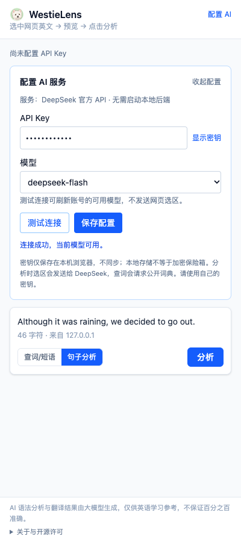
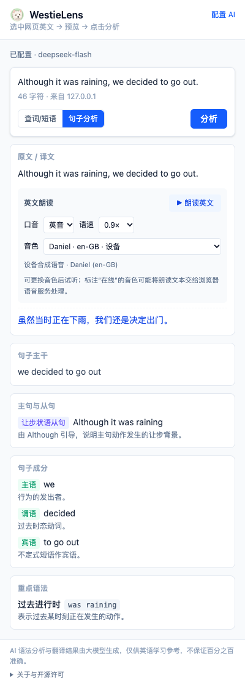
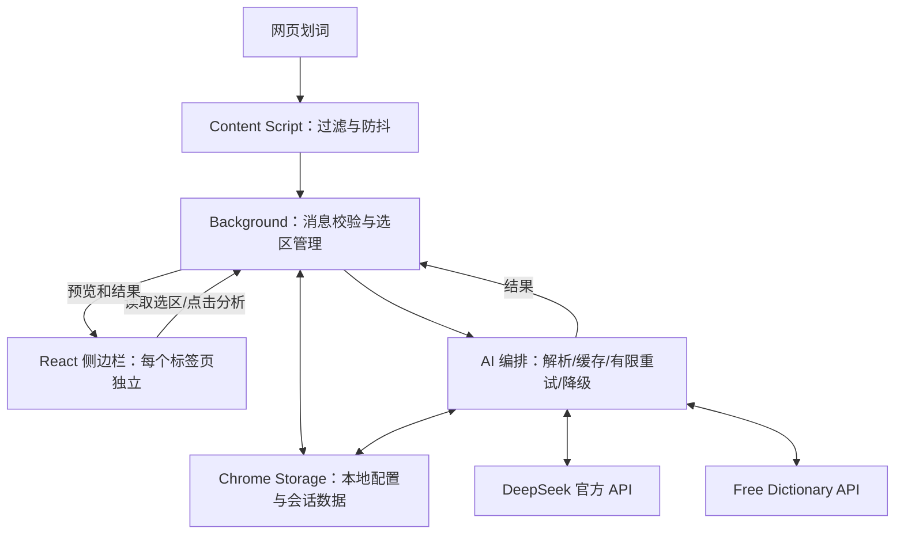

# WestieLens · 西高地伴读


用真实网页学习英文：划词查看中文释义、句子结构、语法讲解、IPA 与英文朗读。

**首发候选：0.1.0-beta.1 · Chrome Manifest V3 · GPL-3.0-only。** 在插件内配置自己的 DeepSeek API Key，直接调用官方服务，无需启动 Java 后端。模型调用费用由使用者的服务商账户承担。

[官网与安装教程](https://westielens.pages.dev/) · [English website](https://westielens.pages.dev/en/)

[开发说明](docs/开发说明书.md) · [架构与代码组织](docs/架构与代码组织.md) · [隐私说明](PRIVACY.md) · [更新记录](CHANGELOG.md) · [参与贡献](CONTRIBUTING.md)

## 安装与开始使用

### 从源码构建

构建环境：Node.js 22+、npm。CI 配置使用 Node 22；本地测试环境与具体结果见[验收清单](docs/v1.0验收清单.md)。

```bash
git clone https://github.com/xinkaic83-dev/WestieLens.git
cd WestieLens/extension
npm ci
npm run build
```

1. 打开 chrome://extensions，开启开发者模式。
2. 点击“加载已解压的扩展程序”，选择 extension/.output/chrome-mv3。
3. 点击插件图标打开侧边栏，在“配置 AI”中填写自己的 DeepSeek API Key。
4. 测试连接后保存；测试连接只读取模型列表，不发送选区，不产生模型生成请求，也不自动保存草稿。
5. 网页选中英文 → 面板显示预览 → 点击“分析”。单词默认查词，多词默认分析，可手动切换。

已保存的密钥不会回传到输入框；修改模型时密钥留空即可沿用。清除配置会删除密钥和结果缓存，保留朗读偏好。模型与账号可用性以实际官方接口为准，测试连接成功不代表余额充足或实际生成一定成功。

### 安装预构建 ZIP

从[官网](https://westielens.pages.dev/#download)下载 WestieLens 0.1.0-beta.1 插件 ZIP，解压后在扩展管理页加载解压目录；目录内应直接包含 manifest.json。官网同时提供对应版本源码和 SHA-256 校验文件。当前没有上架 Chrome Web Store。

从其他开发版本切换时，新的扩展 ID 不共享旧扩展配置，需在新插件内配置自己的密钥。请勿同时启用多个相同用途的开发版本，以免混淆操作入口。

## 界面预览

以下截图使用模拟上游与测试密钥，不包含真实用户数据。




## 核心功能

- 500ms 划词防抖，单次最多 500 字符；预览自动更新，分析由用户主动点击。
- 单词中文释义、词性、英美 IPA 和发音；词典不可用时 AI 兜底，标注音标来源。
- 句子分区展示译文、主干、从句、成分和重点语法；结构异常有限重试，有译文则降级保留。
- 单词和句子英文朗读，可选口音、英文音色、语速并随时停止；词典录音失败回退浏览器语音。
- 每个标签页独立打开侧边栏：A 已打开时切到未打开过的 B 或新页，B 默认收起；返回 A 保留展开和结果。切页停止朗读。
- 选区、结果和旧响应隔离；会话缓存按模型、配置及 Prompt 版本区分，降级结果不缓存。
- 固定官方 API 地址、消息来源及运行时输入/输出校验；共享超时预算和脱敏中文错误。

## 架构



AI 编排运行在 Background 内。backend 目录保留 Java 参考实现，不参与插件主使用链路。详细目录与阅读顺序见[架构与代码组织](docs/架构与代码组织.md)。

## 隐私与边界

- API Key 存在受限的 chrome.storage.local 中，不使用 sync；不向网页脚本、面板输入框或日志回传保存的密钥。本地存储不是加密保险箱。
- 选区和缓存保存在 session，不承诺跨浏览器重启保留；分析/中文补全发送至 DeepSeek，查词会请求公开词典。
- 当前没有项目自建的遥测或广告服务器。在线语音与词典录音可能由第三方服务处理/加载，界面标注来源，详见[隐私说明](PRIVACY.md)。
- 首发目标为 Chrome；声明最低版本 114 不代表完整验证所有旧版能力，原生右键自动打开需要相应 API。Edge 和 Firefox 暂未验收。
- 普通 http/https 网页可用；浏览器内部页、受限商店页面、PDF 与跨域 iframe 不承诺支持。
- 更新或重新加载插件后，刷新此前已打开网页一次。日常连续划词不需要每次刷新。
- AI 结果仅供学习参考，不能保证完全准确；音质取决于设备和浏览器语音。

## 开发和测试

```bash
cd extension
npm ci
npm run compile
npm test
npm run build
npm run e2e
# 可选 31 秒慢响应回归：
E2E_SLOW=1 npm run e2e
# 打包：
npm run zip
```

E2E 使用临时浏览器配置，模型/词典请求由本地测试替身拦截，不使用真实密钥或付费调用。本机 macOS 有 Chrome 时默认使用已安装 Chrome；其他环境见[E2E 说明](extension/e2e/README.md)。

78 条单元测试覆盖消息、配置、解析、超时、缓存、路由与失效清理；完整首发快照的验证状态以[验收记录](docs/v1.0验收清单.md)为准，新公开仓库的远端 CI 必须单独确认。

## 项目目录

| 位置 | 职责 |
|---|---|
| extension/entrypoints | 网页脚本、Background、React 侧边栏入口 |
| extension/services | 配置、官方请求、AI 编排、解析、Prompt、缓存 |
| extension/components | 配置卡、预览、词句结果、朗读、错误和加载 |
| extension/utils | 消息协议、DTO、过滤、路由和语音工具 |
| extension/tests、extension/e2e | 单元测试与真实浏览器回归 |
| extension/public/icon、extension/assets/branding | 西高地图标与设计原图 |
| website | Cloudflare Pages 中英文介绍、安装教程与固定版本下载 |
| backend | Java 17 / Spring Boot 参考实现 |
| docs | 开发规格、架构、验收、命名和许可说明 |

## 许可证与署名

本公开首发仓库的原创代码使用 **[GPLv3，仅第 3 版](LICENSE)**，SPDX：GPL-3.0-only。原项目维护者：[xinkaic83-dev](https://github.com/xinkaic83-dev)。来源与版权见 [NOTICE](NOTICE)。

可以依协议使用、修改和再分发；分发受 GPL 覆盖的修改版需保留适用声明、注明修改，并按 GPLv3 提供对应源码。GPL 允许商用与收费。本软件不提供担保，完整条件以 LICENSE 为准。当前没有额外商业双许可。

第三方组件保留各自许可，见 [THIRD_PARTY_NOTICES.txt](THIRD_PARTY_NOTICES.txt)；该文件不是所有传递依赖及 Java 产物的完整审计。构建会附带许可材料，侧边栏“关于与开源许可”可查看。原始版权行保留作为作者署名，不因更名删除。

这个仓库从独立的 GPLv3 源码快照开始，不携带私有开发仓库历史。发布安装包时同时提供接收者可访问的对应源码；具体见[许可与分发](docs/许可证与分发.md)。

GitHub 为主仓库，Gitee 为镜像。问题反馈请优先在 GitHub 提交；不要在反馈中附带 API Key、敏感选区或私有网页地址。
