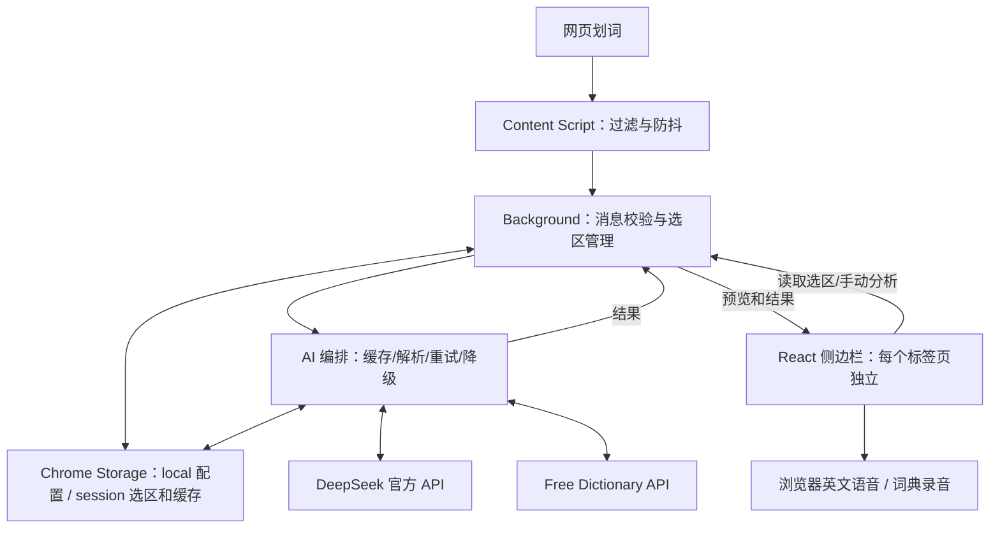

# 架构与代码组织

当前主链路为浏览器插件直连官方 API；backend 为独立 Java 参考实现，不是用户安装依赖。

## 代码目录

| 路径 | 职责 |
|---|---|
| extension/entrypoints/content.ts | 网页选区、过滤、防抖与扩展失效清理 |
| extension/entrypoints/background.ts | 消息入口、来源校验、选区存储、独立侧边栏、右键菜单 |
| extension/entrypoints/sidepanel/App.tsx | 面板状态、选区读取、分析触发和结果展示 |
| extension/services/ai-service.ts | 单词/句子编排、去重、结构重试与兜底 |
| extension/services/http.ts | 固定官方 API 地址、超时预算与脱敏错误 |
| extension/services/settings.ts | 密钥与模型存储、配置保护、脱敏状态 |
| extension/services/parsers.ts | 模型 JSON、原文片段、词典结果运行时校验 |
| extension/services/cache.ts | 有界会话缓存与配置版本隔离 |
| extension/services/prompts.ts | 模型提示词 |
| extension/components/ | 配置、预览、词句结果、朗读、错误和加载组件 |
| extension/utils/ | 数据契约、消息类型、词句路由、过滤和语音工具 |
| extension/tests/ 与 extension/e2e/ | 单元测试与真实浏览器集成 |
| extension/public/icon/ 与 extension/assets/branding/ | 实际图标与设计原图 |
| extension/wxt.config.ts | Manifest、权限、图标、构建及许可文件打包 |
| backend/ | Java 17/Spring Boot 参考实现及测试 |

建议阅读顺序：content.ts → background.ts → App.tsx → services/ai-service.ts，再按需要看解析器、缓存和配置。当前协议见[开发说明书](开发说明书.md)，许可与分发见[许可证与分发](许可证与分发.md)。
